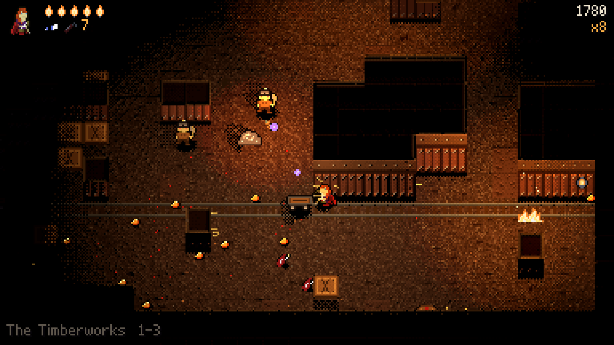
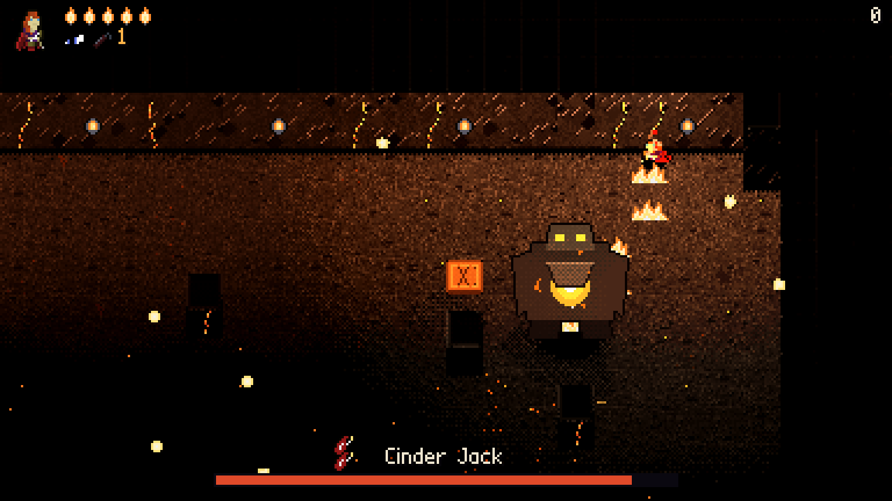
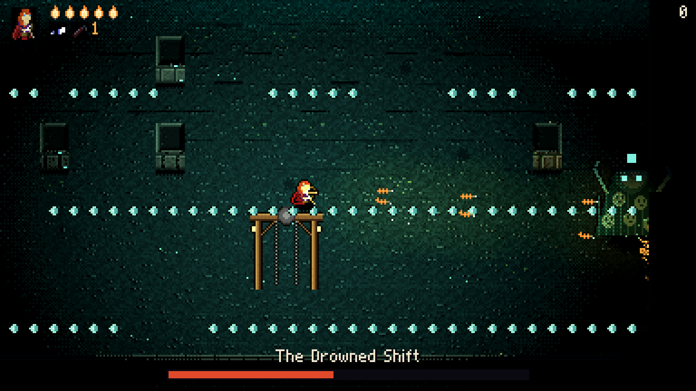
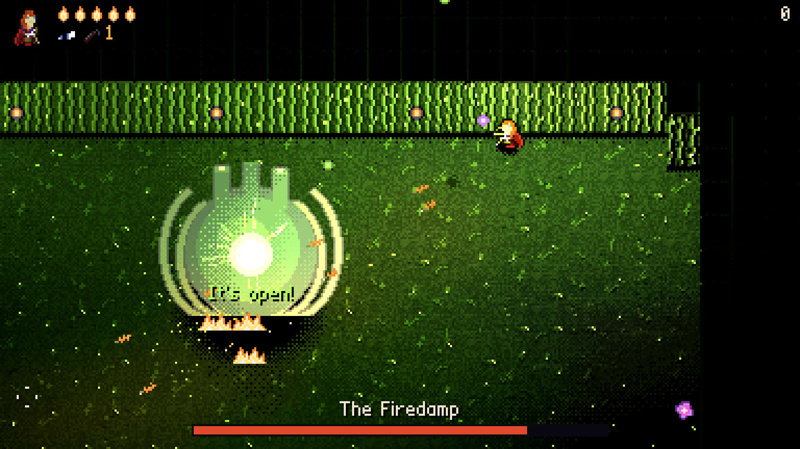

# Firedamp

You carry the only light in the mine.

Firedamp is a twin-stick shooter in a haunted mine, made in Godot 4.7.2. The
night shift at the Hallow Seam didn't come up, so a ranger goes down after them
with a bow, some blasting powder and a lamp. The lamp is your health: each hit
takes a wick off it and it shines less far, and what's out in the dark sleeps
until the light finds it. There are two stances. **Aim** is a fast arrow that
goes through things. **Demolition** is a stick of dynamite on an arrow: it blows
up walls, kegs and armour, and lights the firedamp, the gas that drifts along
the floor and goes up all at once. Five depths, each with its own things living
in it and something big at the bottom, and between levels the cage finds you
something new to carry. It plays with a mouse, a keyboard, a pad or a finger, on
Windows, Linux and in a browser.

It began as a libGDX game, in 2015, and was never finished: the Java is in this
repository's history (up to commit `a88ee2a`). This is a rewrite rather than a
port, keeping its idea (a ranger as a light source, in the dark, under that
camera: orthographic, 53 degrees down, walls in 3D and people as flat sprites),
its art (the ranger, the planks, the dirt, the stance icons, which its code
never got as far as using) and its stick-pushing dead zone. Everything else is
new. Every number worth tuning is in one place, `src/data/balance.gd`.






## Running

```sh
../Godot/Godot_v4.7.2-stable_linux.x86_64 --path .
```

Or open the folder in the Godot 4.7 editor and press Play. It uses the
Compatibility renderer everywhere, so the same game runs on a desktop and in
WebGL 2.

### Controls

|              | Mouse and keys      | Keys alone | Pad          | Touch        |
|--------------|---------------------|------------|--------------|--------------|
| Walk         | WASD                | WASD       | Left stick   | Left thumb   |
| Shoot        | Left click          | Arrow keys | Right stick  | Right thumb  |
| Change stance| Right click, Q or E | Q or E     | LB (or X, Y) | Stance       |
| Roll         | Space or Shift      | Space      | RB, LT or A  | Roll         |
| Pause        | Esc                 | Esc        | Start        |              |

F11 or Alt+Enter is full screen. On a pad the right trigger shoots too, the way
the ranger's walking if the stick is let go. In Demolition the stick only aims,
until it's pushed all the way: that throws one charge, and it takes another push
to throw the next.

### On a Steam Deck

Build it (`./build_game.sh Linux --zip`), copy `builds/Firedamp-Linux-<commit>.zip`
over, and unzip it. In Desktop Mode, in Steam, use Add a Game > Add a Non-Steam
Game on `Firedamp.x86_64`, then go back to Gaming Mode and start it from there.
Start it through Steam: Steam Input's controller is only seen by a game Steam
launched. If the sticks do nothing, pick a Gamepad layout under its controller
settings.

The game knows a Deck by itself (`SteamDeck=1`, or Valve's board name), starts in
full screen, starts on the pad, and calls the buttons L1, R1 and Menu. It draws at
3x, 426 by 266 game pixels; docked it fits whatever the screen is. A tap on the
screen brings up the on-screen sticks and the next push of a real stick takes them
away. Losing the controller pauses the game.

### Building

```sh
./build_game.sh
```

exports every preset in `export_presets.cfg` whose export template is installed
(Windows, Linux and Web) into `builds/<preset>/`, with the engine's notices
(`GODOT_COPYRIGHT.txt`) and `CREDITS.txt` beside the game; a preset without its
template is skipped, with a line saying so. `./build_game.sh Web Linux` builds
just those; `--zip` also makes `builds/Firedamp-<preset>-<commit>.zip` of each. It
imports and checks every script compiles first, as an export lets broken ones
through, and draws the Windows icon, `icon.ico`, from `icon.svg`. The commit goes
into the build as `commit.txt` for the title's version. It uses the stock editor
in `../Godot/` (beside the main checkout, from a worktree) and its installed 4.7.2
export templates; `GODOT=/path/to/godot` points it at another.

**Web** is the single-threaded build, so it runs on itch.io and anywhere else
without the cross-origin isolation headers threads need.
`builds/Web/index.html` is the page.

`./upload_to_itchio.sh` pushes what's been built to `pigmassacre/firedamp` with
butler (`--dry-run` shows what it would do first). The page has yet to be made.

## How it's made

The game is played on a flat plane of pixels (`x`, `y` down the screen, and `h`
up off the floor), and drawn in real 3D, stretched just so that a pixel of floor,
of a wall's face and of an upright sprite each land on exactly one pixel of the
screen (`src/play/iso.gd`). The whole thing is rendered at about 384 by 216 and
scaled up by a whole number (Godot's `viewport` stretch mode), which is how real
lights, real shadows and normal maps get to be pixel art. The light is stepped
into bands and dithered between them by its own `light()` function
(`src/shaders/lit.gdshaderinc`).

    src/main.gd               the root: screens, and the testing flags
    src/autoload/             Inputs, Audio, Game (settings, saves)
    src/data/                 balance, the depths, the enemies, the perks; sheets.gd is generated
    src/play/world.gd         one level, and everything in it, at 60 steps a second
    src/play/level_gen.gd     digs the levels
    src/play/map_view.gd      draws them: a mesh per chunk, built again when a wall comes down
    src/play/enemies/         how each thing behaves, the bosses included (boss.gd)
    src/play/gas.gd           firedamp, and things on fire
    src/shaders/              the light, tiles, sprites, shots, gas
    src/ui/                   the HUD and the menus
    tools/                    what makes the assets (below)
    art/original/             the original game's art, as it was

### The assets

All of it is generated, and checked in:

```sh
python3 tools/make_sprites.py   # every sprite, as text in the script itself, and src/data/sheets.gd
python3 tools/make_tiles.py     # the tiles of each depth, with normal maps and what glows
python3 tools/make_font.py      # the two pixel fonts, as BMFonts
python3 tools/import_audio.py   # the sounds and music, from ../Assets, with ffmpeg
```

### Testing without playing

```sh
GODOT=../Godot/Godot_v4.7.2-stable_linux.x86_64
$GODOT --headless --path . --script src/debug/test_levels.gd      # digs 520 levels and checks them
$GODOT --headless --path . -- --screen=play --autoplay --speed=8  # the game plays itself
$GODOT --path . -- --screen=play --level=7 --autoplay --invincible --shots=5,10 --size=1536x864
$GODOT --path . -- --screen=play --input-test                     # sends the controls real input events
python3 tools/test_deck.py                                        # plays from the title at 1280x800 with a virtual controller
```

`--autoplay` is a bot (`src/debug/autopilot.gd`), `--level=` starts on that level
of the 18 (the bosses are 3, 7, 11, 15 and 17), `--seed=` fixes the seed,
`--perks=twin,fire` hands those out, `--shots=` saves screenshots to `shots/`,
`--deck` pretends to be a Steam Deck (with `--size=1280x800` to keep it in a window),
and `--show=perk` (or `pause`, or `over`) brings up that screen. `src/main.gd`
has the rest.
